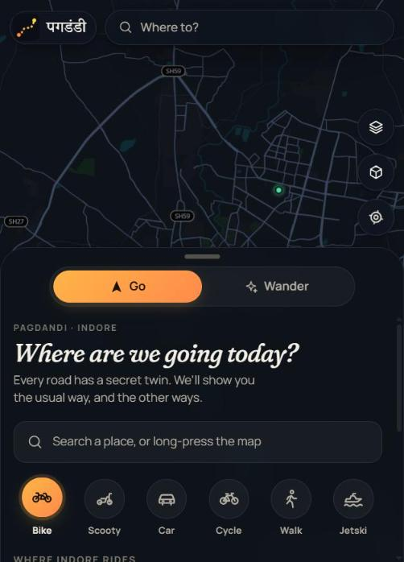
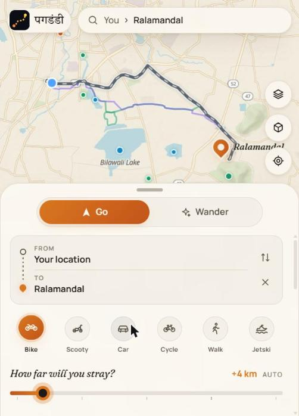
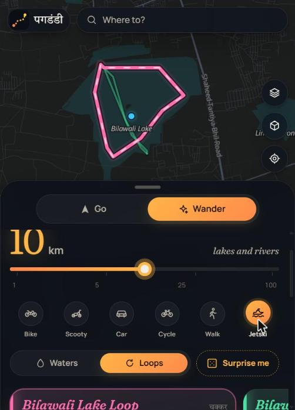
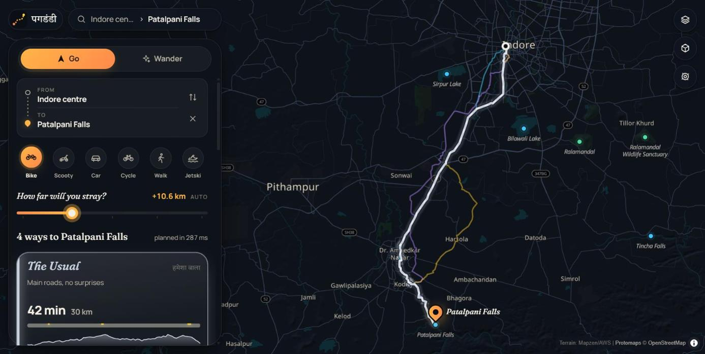
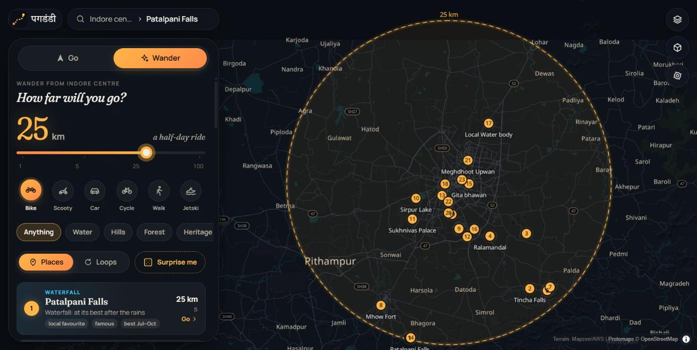

# Pagdandi

**पगडंडी**: a narrow path worn by people walking it.

Maps show you the road everyone takes. Pagdandi shows that one too, and then the others: the
**shortcut** through the village, the **kaccha** track, the **quiet lanes**, the **scenic** detour by
the lake, and the road that only just appeared on the map. Or skip the destination entirely and
**wander**: pick how far you'll go and it finds places and loops within reach. Bike, scooty, car,
cycle, on foot, or by jetski on the lakes. It covers Indore and everywhere within 125 km.

<p>
  
  
  
</p>



## What it does

- **Go (A → B).** The usual route and up to five others, each with a character and an honest one-line reason:
  *Shortcut* (fewest km), *Kaccha* (dirt, gravel, village roads), *Quiet Lanes* (away from busy roads),
  *Scenic* (bent through a lakeshore, forest edge or viewpoint), *New Ground* (roads mapped in the last 18 months).
  A **"How far will you stray?"** slider (0–40 km over the usual) sets the detour budget.
- **Wander.** A radius from 1 to 100 km (on an exponential slider) and a mood: anything, water, hills,
  forest, heritage, offbeat or new on the map. **Places** gives numbered gems with a reason to go;
  **Loops** gives round trips that come back a different way. 🎲 **Surprise me** reshuffles.
- **Every trail tells you** its surface ribbon (paved/gravel/dirt), the elevation profile and total climb,
  how quiet and how scenic it is, what's along the way ("Along Sirpur Lake 1.2 km"), new roads on it, and
  heads-ups: unpaved distance, monsoon mud, sunset before arrival, steep grades, rough tracks.
- **Six ways to move.** Bike, scooty (gentler on rough tracks, 50 km/h), car, cycle, walk and **jetski**:
  water routing on lakes, reservoirs and the Narmada, with open-water and shoreline styles and lake circuits.
- **Ride.** Turn-by-turn with voice, a "what's ahead" line ("Kaccha starts in 300 m"), off-route
  rerouting, screen wake lock, and a **Preview** fly-through of any trail.
- **Looks.** Two moods: **Dusk** (an ink-blue atlas where routes glow like light trails) and **Day**
  (warm paper "field notes"). **Auto** switches at Indore's real sunset. There's also a satellite base,
  3D terrain, and a layer that highlights roads new on the map.

## Run it

```sh
make bootstrap   # GraphHopper, osmium, pmtiles; .env; web deps
make data        # Indore: OSM → graph (with elevation), tiles, scenic layers (~5 min)
make dev         # http://localhost:5173
```

Needs Java 17+, Go 1.24+, Node 20+. On an 8 GB laptop the whole data build takes about 5 minutes.
See [OPERATIONS](docs/OPERATIONS.md) for details and production.

## How it works

```
apps/web/          React 19 + MapLibre PWA (no UI framework, hand-made design system)
services/api/      Go: cmd/api (stateless HTTP API), cmd/datactl (data pipeline)
  internal/plan    trail characters, scoring, detour budget, Wander places and loops
  internal/water   jetski routing on the water grid
  internal/raster  50 m land grid: water, forest, built-up, protected, fields…
infra/             GraphHopper config + base models, docker-compose, Caddy
data/region.yaml   the served region (Indore, 125 km) and local favourites
```

GraphHopper routes on OpenStreetMap with four permissive base profiles (car, moto, cycle, walk). The API asks
it for each trail *character* with a per-request custom model that only lowers priorities, then scores each
result against a 50 m land grid built from OSM (water, forest, built-up area and so on), elevation, road classes
and OSM edit history. No accounts, no database. Map data © OpenStreetMap contributors.

## Docs

- [docs/SPEC.md](docs/SPEC.md): product and architecture (source of truth)
- [docs/DECISIONS.md](docs/DECISIONS.md): the calls made and why
- [docs/OPERATIONS.md](docs/OPERATIONS.md): running, data builds, deploy
- [docs/PROGRESS.md](docs/PROGRESS.md): status and known gaps

## Safety

Unpaved and new roads change with the seasons; labels are honest guesses from OpenStreetMap. Ride at your own
judgement. Pagdandi never routes two-wheelers onto motorways, and never through private land or military areas.
