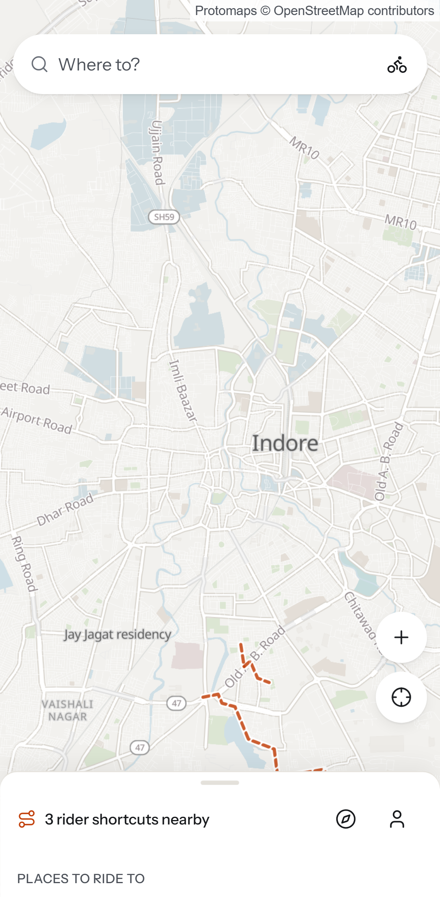
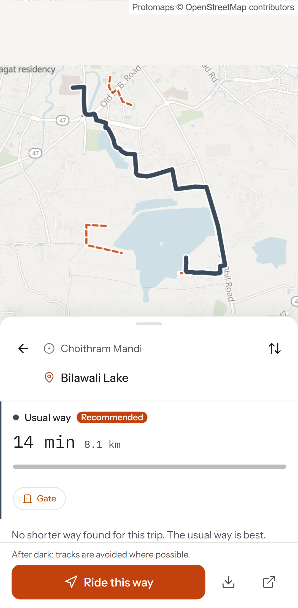
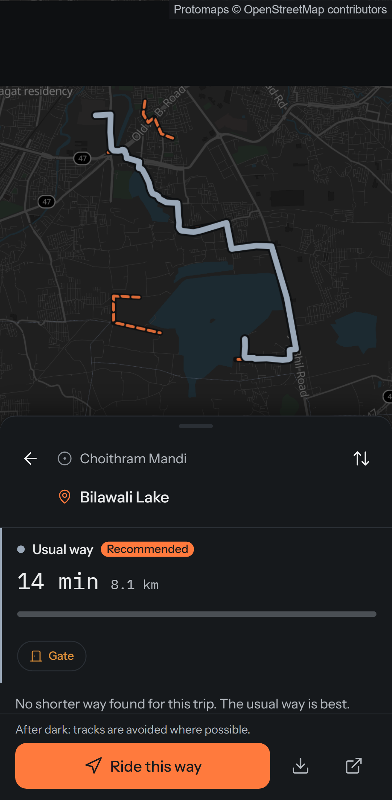

# Pagdandi

**पगडंडी** — "a narrow path worn by people walking it."

Pagdandi is a maps app for two-wheelers in India (and bicycles and mopeds in Stockholm). It shows the
**usual route side by side with a shorter "pagdandi"** through lanes, tracks and rider-known
shortcuts. Each shortcut carries an honest label: its surface, when riders last confirmed it, and
how confident the app is that it's passable today.

<p>
  
  
  
</p>

## What it does

- **Route compare.** The usual way (paved, public) and up to three pagdandi options, with time saved,
  a surface bar (paved / kaccha / track), confidence ("High · confirmed 3 days ago by 4 riders") and
  warnings (gate, kaccha 1.2 km, night, monsoon). The usual way is never hidden.
- **Community shortcuts.** Riders draw or record shortcuts; endpoints snap to real OSM roads. Others
  confirm them as passable or blocked. Confidence is a Bayesian score that decays faster in the
  monsoon. A shortcut goes live after two independent confirmations.
- **Safe by construction.** Never routes through private, no-entry or military areas, or onto roads
  closed to two-wheelers (expressways, sea links). Rules live in data, not code. Routing is more
  conservative at night and in the monsoon or winter.
- **Turn-by-turn navigation** with voice in English, Hindi and Swedish, off-route rerouting, a screen
  wake lock, "kaccha road in 200 m" warnings, and a one-question check after rides that used a rider
  shortcut.
- **Desire paths.** Opt-in ride traces reveal paths that ≥ 3 riders cut through. Nearby riders are
  asked whether the path is usable.
- **PWA.** Installable; offline map packs for 25 km around each city.

## Stack

GraphHopper 11.1 (custom models, landmarks) · Go API and worker · PostgreSQL + PostGIS · Redis ·
React 19 + TypeScript + Vite · MapLibre GL with self-hosted Protomaps PMTiles · Tailwind v4
(tokens only) · Playwright, Vitest, axe, Lighthouse. Map data © OpenStreetMap contributors (ODbL).
No Google data is used; "Open in Google Maps" is only a deep link.

## Quick start

```sh
make bootstrap              # tools, .env, Postgres + Redis, migrations, web deps
make data REGION=indore     # Indore + Mhow + Ujjain (~10 min on an 8 GB laptop)
make seed-dev               # demo shortcuts near Bilawali lake (titled "Demo: …")
make dev                    # http://localhost:5173
```

Sign-in links are printed in `data/build/logs/api.log` during development. `make help` lists every
target. Docker is used when available; otherwise everything runs natively (see
[OPERATIONS](docs/OPERATIONS.md)).

## Repository

```
apps/web/            React PWA
services/api/        Go: cmd/api, cmd/worker, cmd/datactl; internal/… ; api/openapi.yaml
infra/               docker-compose, Caddy, GraphHopper models and configs, osmium helpers
data/                regions.yaml, overrides, resolved destinations (build output in data/build)
tests/fixtures/      synthetic-town.osm for deterministic routing tests
docs/                SPEC, PROGRESS, DECISIONS, OPERATIONS, screenshots
```

## Documentation

- [docs/SPEC.md](docs/SPEC.md) — product and architecture (source of truth)
- [docs/PROGRESS.md](docs/PROGRESS.md) — milestone status and open issues
- [docs/DECISIONS.md](docs/DECISIONS.md) — every decision the spec left open, with reasons
- [docs/OPERATIONS.md](docs/OPERATIONS.md) — running, data builds, testing, deploy, monitoring

## Safety

Unverified roads can change. Ride at your own judgement.
